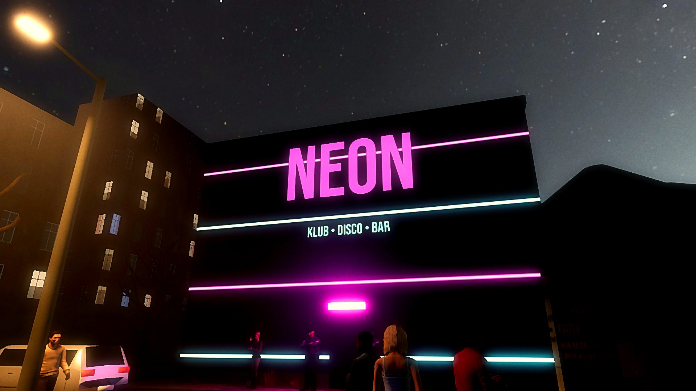
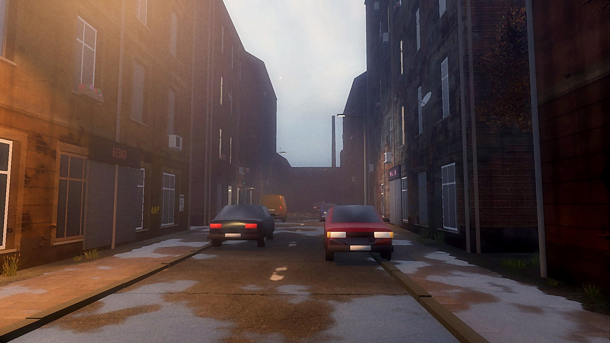
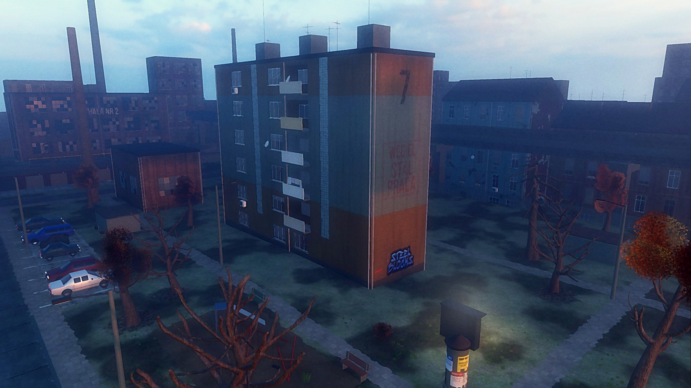
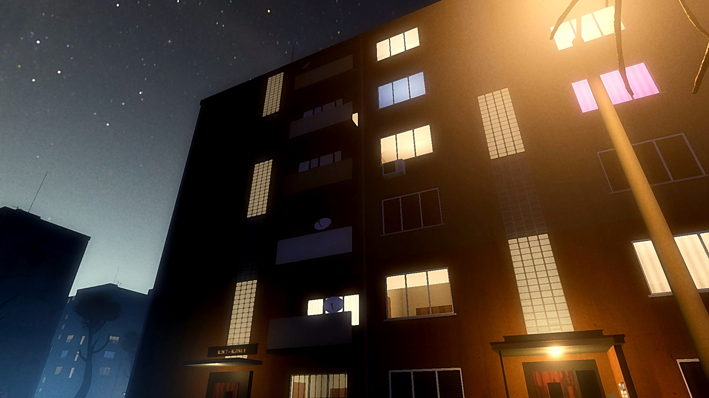
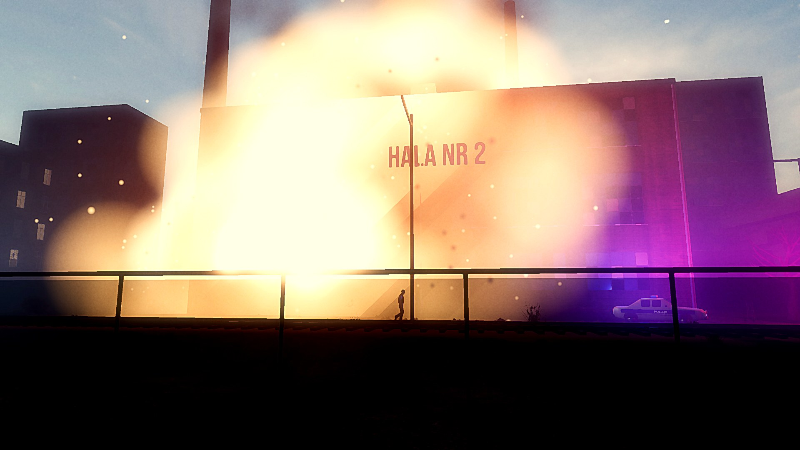
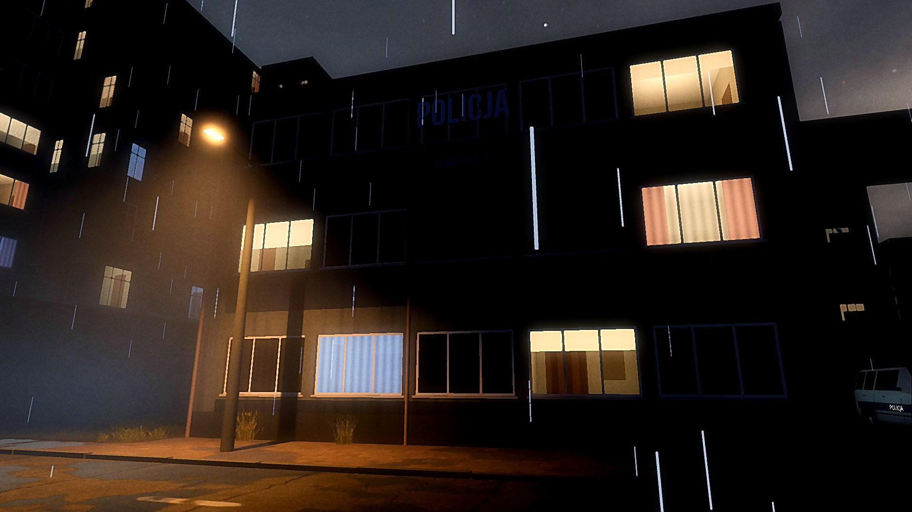
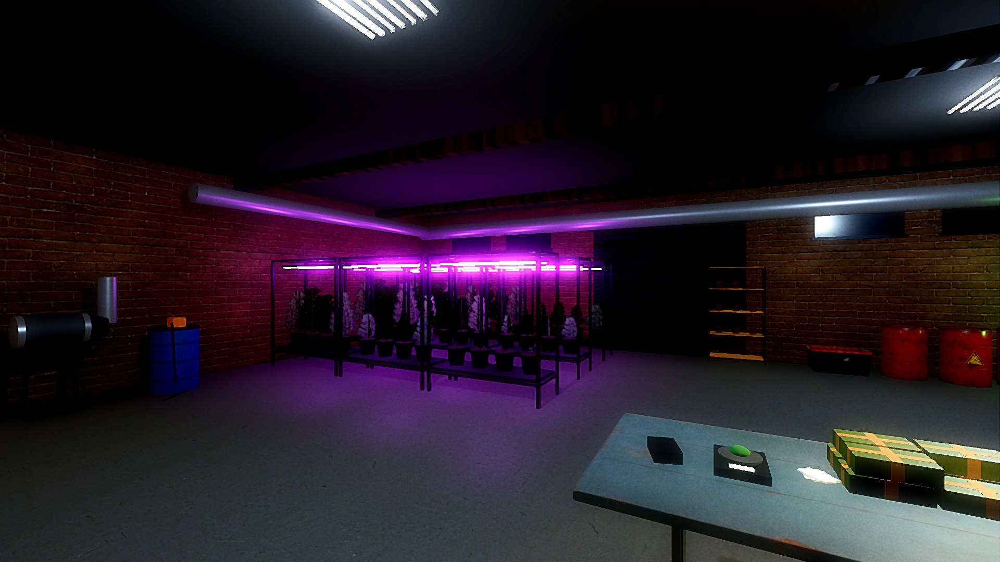

# Czarny Rynek

**Pierwszoosobowa gra o półświatku w fikcyjnym polskim mieście.**
Produkuj, handluj, negocjuj, uciekaj przed policją i spłać dług, zanim on spłaci Ciebie.

&nbsp;

&nbsp;

## O grze

Ostatnia noc w laboratorium w Starej Hucie kończy się nalotem, ucieczką przez tory i wybuchem, po którym zostajesz
z niczym — poza długiem u Wiktora. Trzy tygodnie później zaczynasz od zera w wynajętej kawalerce na blokowisku.

- **Otwarte miasto:** blokowiska, kamienice przy Hutniczej, klub Neon, bazar, garaże, ogródki działkowe, tory i Stara Huta.
- **Handel z ludźmi, nie z tabelką:** klienci mają charaktery i nastroje, z każdym negocjujesz osobno, a stali klienci
  dzwonią z kolejnymi kawałkami historii o tym, kto sprzedał ekipę.
- **Produkcja:** od szafy grzybowej po stół laboratoryjny. Lepszy sprzęt to lepszy towar i większe ryzyko nalotu.
- **Policja i skradanie:** patrole z latarkami, kordon, pościgi. Kucanie, cień i krzaki naprawdę pomagają.
- **Dzień i noc, pogoda, deszcz, mgła** — miasto wygląda i zachowuje się inaczej o każdej porze.
- **Rozwój:** poziomy, umiejętności, ubrania wpływające na to, jak bardzo rzucasz się w oczy, ekipa i kryjówki.

> Wszystko w grze jest fikcją. Gra porusza tematy narkotyków i przestępczości — przeznaczona dla dorosłych (18+).

<table>
<tr>
<td></td>
<td></td>
</tr>
<tr>
<td></td>
<td></td>
</tr>
<tr>
<td></td>
<td></td>
</tr>
</table>

## Jak zagrać

1. Wejdź w **[Wydania (Releases)](https://github.com/piotrpilka123-ctrl/czarny-rynek/releases/latest)** i pobierz paczkę dla swojego systemu.
2. Rozpakuj i uruchom — **Godot nie jest potrzebny**.
   - **Windows:** `CzarnyRynek.exe`. Na słabszej karcie (np. Intel Iris Xe) użyj `Czarny Rynek - tryb zgodnosci.bat`.
   - **macOS:** kliknij `Czarny Rynek.app` prawym przyciskiem → **Otwórz** (aplikacja nie jest podpisana przez Apple).
   - **Linux:** `./CzarnyRynek.x86_64`.

**Sterowanie:** WASD — ruch, mysz — rozglądanie, E — interakcja, F11 — pełny ekran. Resztę klawiszy gra pokazuje w samouczku.

Własna muzyka do klubu: wrzuć pliki MP3 do folderu `muzyka` obok gry.

<b>Uruchomienie z kodu źródłowego (dla twórców)</b>

- **macOS:** zainstaluj Godot 4.7 i otwórz `Uruchom Czarny Rynek.command`. Skrypt oczekuje Godota w `/Applications/Godot.app`.
- **Windows:** zainstaluj lub rozpakuj Godot 4.7.2 do folderu `Godot` obok projektu i kliknij `Uruchom Czarny Rynek.bat`
  (domyślnie tryb zgodności OpenGL). Logi: `import-windows.log` i `gra-windows.log`.
- **Linux / edytor:** zaimportuj `godot/project.godot` w Godocie 4.7 i naciśnij **F5**.

Pierwsze uruchomienie importuje modele i tekstury, dlatego trwa dłużej. Paczki w Wydaniach buduje automatycznie
GitHub Actions (`.github/workflows/wydanie.yml`) po wypchnięciu tagu wersji, np. `v0.9`.

## English

**Czarny Rynek** ("Black Market") is a first-person underworld sim set in a fictional Polish city.
After a police raid blows up your drug lab, you start over in a rented flat with nothing but a debt to pay off:
produce, deal with characters who have their own moods and stories, sneak past flashlight patrols, and grow a crew.
Open city with day/night cycle and weather, built in Godot 4. The game is in Polish. Fictional; for adults (18+).

**[Download for Windows, macOS or Linux](https://github.com/piotrpilka123-ctrl/czarny-rynek/releases/latest)** — no Godot installation needed.

## Autor i licencje

Gra Piotra Piłki. Autorzy i licencje zasobów (modele, tekstury, dźwięki, muzyka, czcionki): [LICENCJE.md](LICENCJE.md).

Podoba Ci się? Zostaw ⭐ — to najprostszy sposób, żeby więcej osób trafiło na grę.
